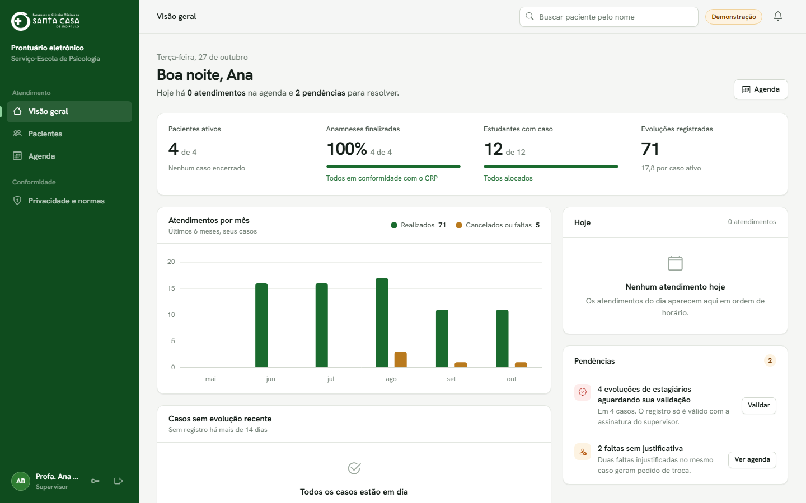
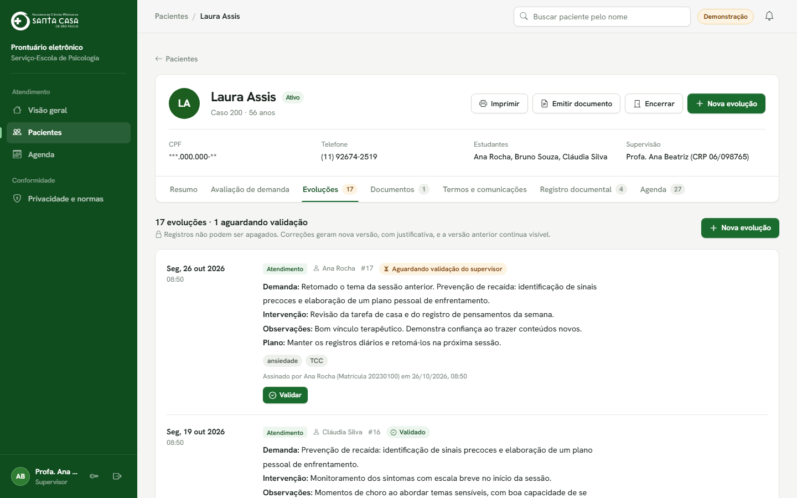
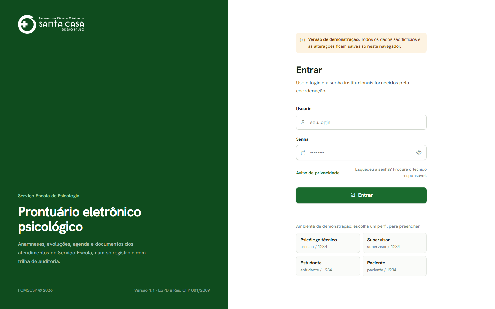
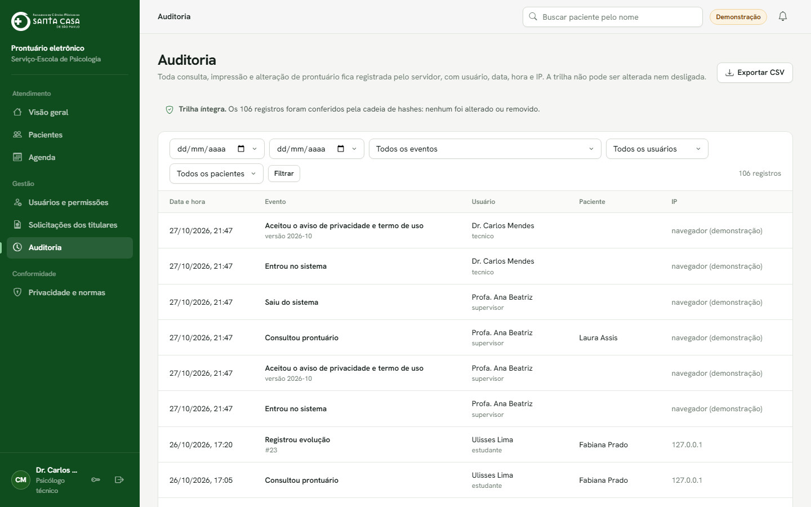

<div align="center">

# 🧠 PEP — Prontuário Eletrônico do Paciente

### Sistema de prontuário clínico para o Serviço-Escola de Psicologia da Faculdade de Ciências Médicas da Santa Casa de São Paulo


[](https://github.com/RafaelNazareth/prontuario/actions/workflows/testes.yml)


### [🔗 **Acessar o projeto rodando**](https://rafaelnazareth.github.io/prontuario/)

</div>

---

## 📌 Contexto

O **PEP** é um sistema real, sendo desenvolvido para o **Serviço-Escola de Psicologia** da **Faculdade de Ciências Médicas da Santa Casa de São Paulo (FCMSCSP)** — a clínica onde alunos de graduação em Psicologia realizam atendimentos supervisionados. Este repositório é também meu **Trabalho Integrador de Competências** do curso de Análise e Desenvolvimento de Sistemas.

Os dados manipulados são clínicos e sensíveis (contexto de **LGPD**), e os usuários finais — técnicos, supervisores, estudantes e pacientes — não têm formação técnica. Isso influenciou decisões concretas de código, descritas abaixo.

---

## 🖼️ Telas

| Visão geral do supervisor | Prontuário com co-assinatura |
|---|---|
|  |  |

| Login | Trilha de auditoria |
|---|---|
|  |  |

---

## 🚀 Como acessar

**Demonstração online:** [rafaelnazareth.github.io/prontuario](https://rafaelnazareth.github.io/prontuario/). Use um dos logins de teste abaixo; a senha de todos é `1234`.

| Perfil | Login |
|---|---|
| Psicólogo técnico (responsável técnico) | `tecnico` |
| Supervisor | `supervisor` |
| Estudante | `estudante` |
| Paciente | `paciente` |

No GitHub Pages não há servidor, então o sistema entra sozinho em **modo demonstração**. A parte do servidor roda dentro do navegador, com as mesmas regras da versão completa. Os dados são fictícios e as alterações ficam salvas só no navegador de quem está testando; o selo "Demonstração" no topo permite restaurar os dados de exemplo.

**Versão completa (local):** com Node.js 20+, rode `npm install` e `npm run dev` e acesse `http://localhost:5500`. Nesse modo, login, permissões e auditoria rodam no servidor. Os dados ficam em `data/db.json` e os arquivos anexados, cifrados, em `data/arquivos/`.

**Com MongoDB:** `PEP_BANCO=mongodb PEP_MONGODB_URI="mongodb://..." npm run dev`. Para levar os dados do JSON para o MongoDB, use `npm run data:migrar-mongodb`. Variáveis, chaves, HTTPS e backups estão no [guia de implantação](docs/IMPLANTACAO.md).

**Testes:** `npm test` roda a suíte automatizada (`node:test`) e `npm run lint` roda o ESLint. Os dois rodam também no GitHub Actions a cada envio.

---

## 🏗️ Como o projeto é estruturado hoje

Sem bundler e sem framework de UI. O front-end roda como **ES Modules nativos do navegador**, e o servidor é Node.js puro. A única dependência de execução é o driver do MongoDB, opcional e carregado só quando o banco escolhido é o MongoDB.

```
index.html
assets/
├── css/styles.css
└── js/
    ├── main.js              → ponto de entrada; expõe funções para os onclick do HTML
    ├── core/                → sessão e navegação, estado, permissões, datas, regras clínicas
    ├── pages/               → uma função render*() por tela
    ├── modals/              → formulários e ações de registro clínico
    ├── repositories/        → acesso aos dados por entidade
    ├── shared/              → regras usadas pelo servidor e pelo modo demonstração:
    │                          permissões, auditoria, usuários, arquivos, política de senha, configuração
    └── infrastructure/      → comunicação com a API e servidor simulado (demonstração)
server/                      → servidor Node: autenticação, API, auditoria, backup e arquivos cifrados
server/banco/                → banco em arquivo JSON (padrão) ou MongoDB, com a mesma interface
data/seed.json               → dados de demonstração (fictícios)
data/instituicao.exemplo.json → modelo dos dados reais da instituição (preenchido na implantação)
scripts/                     → geração de agenda, restauração de backup e migração para MongoDB
tests/                       → testes automatizados (node:test)
docs/                        → guia técnico, conformidade e documentação de arquitetura
```

O sistema começou como um único `app.js`, foi modularizado em ES Modules e depois ganhou um servidor próprio para tirar do navegador as decisões de segurança.

Detalhes de arquitetura, scripts e dados estão no [guia técnico](docs/GUIA_TECNICO.md).

---

## 🔐 Decisões pensadas para dados clínicos reais

O sistema foi revisado contra as normas do **Conselho Federal de Psicologia** e a **LGPD**, e usa os requisitos de segurança da **SBIS** para prontuários eletrônicos como referência técnica. **Ele não é certificado pela SBIS.** A matriz completa, com cada requisito, a fonte e onde está no código, está em [docs/CONFORMIDADE.md](docs/CONFORMIDADE.md).

> **Onde estas proteções valem:** na versão com servidor (`npm run dev`). A demonstração online simula as mesmas regras (permissões, co-assinatura, retificação e auditoria), mas roda inteira no navegador e **não protege os dados**, por isso usa apenas dados fictícios.

**Segurança decidida no servidor.**
- Cada papel recebe só os pacientes que pode ver: o técnico vê todos; o supervisor, os que supervisiona; o estudante, os do seu grupo; o paciente, só o próprio prontuário.
- Toda gravação é conferida item a item antes de ir para o disco.

**Senhas e sessão.**
- Senhas guardadas com hash scrypt e salt.
- Bloqueio após 5 tentativas erradas e mensagem de erro genérica.
- Sessão em cookie HttpOnly, encerrada após 15 minutos sem atividade, com aviso antes.

**Arquivos anexados protegidos.**
- Só PDF, PNG, JPEG e Word (.docx), até 10 MB. O tipo é conferido pelo conteúdo do arquivo, não pela extensão.
- Gravados cifrados (AES-256-GCM). O SHA-256 fica no prontuário e é conferido a cada download, que entra na auditoria.
- Quem baixa é quem pode ver o registro: o paciente baixa os próprios documentos, mas não o material de testes.

**Prontuário conforme o CFP.**
- Seções obrigatórias: identificação, avaliação de demanda, objetivos, evoluções, encerramento e cópias dos documentos emitidos.
- Supervisões e material de testes ficam num registro documental separado, que o paciente não acessa.

**Assinatura do estagiário e do supervisor.** Evoluções, avaliações e documentos de estagiários só valem depois da co-assinatura do supervisor do caso.

**Nada é apagado.** Correções são retificações feitas pelo próprio autor, com justificativa, e a versão anterior continua visível.

**Trilha de auditoria.**
- Registra quem consultou, imprimiu ou alterou cada prontuário, com IP, sem dados clínicos no log.
- Cada registro está encadeado ao anterior por hash, então qualquer adulteração é detectada.

**Direitos do paciente.**
- Acesso integral ao próprio prontuário: impresso pelo técnico ou consultado pelo paciente com um acesso temporário (login e senha gerados pelo sistema, com prazo de validade). O acesso do paciente é só de consulta.
- Solicitações pela LGPD com prazo de 15 dias, feitas presencialmente, por telefone ou e-mail e registradas pelo técnico.
- Consentimentos versionados e revogáveis, com autorização do responsável para menores.

---

## ✨ Funcionalidades implementadas

- **Login:** quatro papéis, aceite de aviso de privacidade e termo de sigilo, troca obrigatória da senha provisória no primeiro acesso da equipe e bloqueio por tentativas.
- **Dashboard:** indicadores, gráfico de atendimentos, agenda do dia e pendências, incluindo validações do supervisor.
- **Prontuário completo:**
  - avaliação de demanda e objetivos;
  - evoluções com validação e retificação;
  - documentos;
  - termos e comunicações;
  - registro documental;
  - agenda do paciente.
- **Documentos psicológicos conforme a Res. CFP 06/2019:**
  - declaração, atestado, relatório, laudo e parecer;
  - impressão com páginas numeradas, protocolo de entrega e devolutiva.
- **Agenda semanal:** só o técnico responsável agenda, remarca e cancela, com conferência de conflito de horário do paciente e do estagiário. A equipe do caso registra faltas; técnico ou supervisor justificam. Troca de paciente após faltas (dados de exemplo até dezembro de 2026).
- **Pedidos de agendamento:** o paciente pede agendamento, remarcação ou cancelamento presencialmente, por telefone ou e-mail; o técnico registra o pedido na Agenda ("Registrar pedido", com o canal) e atende ou recusa explicando o motivo.
- **Acesso temporário do paciente:** quando o paciente pede o prontuário, o técnico imprime ou gera um acesso temporário (login `pac<caso>` e senha aleatória mostrada uma única vez, com opção de imprimir). Vencido o prazo, o login é recusado. O paciente só consulta: prontuário, próximos atendimentos, download dos próprios documentos e impressão.
- **Upload e download reais de documentos**, com arquivos cifrados e verificação de integridade.
- **Notificações** de evolução pendente, faltas e trocas, e **busca global** de pacientes.
- **Encerramento de atendimento** com motivo e encaminhamento.
- **Gestão de usuários:** cadastro, edição de nome, login, papel, CRP e matrícula, senha inicial ou provisória definida pelo técnico com troca obrigatória no primeiro acesso, inativação em vez de exclusão e acesso temporário dos pacientes ao prontuário. Tudo com confirmação da senha do técnico e registro na auditoria.
- **Paginação** nas listas de pacientes, equipe, acesso temporário dos pacientes e trilha de auditoria.
- **Auditoria:** filtros, exportação CSV e verificação de integridade.
- **Backup cifrado (AES-256-GCM)** com restauração verificada (versão com servidor). No banco JSON, os arquivos anexados também são copiados; no MongoDB, entram no `mongodump`.
- **Banco JSON ou MongoDB**, escolhido por variável de ambiente, com script de migração.
- **Interface responsiva.**

---

## 🚧 O que ainda não existe

- **Publicação para uso real:** precisa de hospedagem com Node.js, HTTPS e disco cifrado. O GitHub Pages serve apenas a demonstração. O que a implantação precisa está em [docs/IMPLANTACAO.md](docs/IMPLANTACAO.md).
- **Assinatura com certificado digital ICP-Brasil:** hoje a assinatura é eletrônica, por login individual mais o hash do conteúdo.
- **Verificação em duas etapas (MFA).**
- **Banco de dados em produção:** o adaptador MongoDB existe e é testado, mas nenhum ambiente real foi migrado. O servidor ainda carrega o conjunto inteiro de dados a cada requisição; ler só o necessário por consulta é um passo futuro.
- **Testes de ponta a ponta no navegador (E2E).**

---

## 🗺️ Próximos passos

- [ ] Publicar a versão completa em hospedagem com Node.js e HTTPS
- [ ] Cumprir o checklist institucional de [docs/CONFORMIDADE.md](docs/CONFORMIDADE.md): dados do encarregado e prazo do acesso temporário do paciente em `data/instituicao.json`, plano de incidentes e troca das senhas de demonstração
- [ ] Migrar a produção para o MongoDB e passar a ler os dados por consulta
- [ ] Avaliar assinatura com certificado ICP-Brasil e MFA
- [ ] Testes E2E dos fluxos de cada papel
- [ ] Implantação para uso real pelo Serviço-Escola de Psicologia da FCMSCSP

---

## 👤 Autor

**Rafael Nazareth**
Estudante de Análise e Desenvolvimento de Sistemas — FCMSCSP (2026–2027)
Ex-supervisor de operações de telemarketing em transição para desenvolvimento full-stack

- GitHub: [@RafaelNazareth](https://github.com/RafaelNazareth)
- LinkedIn: [linkedin.com/in/rafaelnazarethdev](https://linkedin.com/in/rafaelnazarethdev)

---

> Este projeto é o Trabalho Integrador de Competências do curso de ADS da FCMSCSP, com objetivo real de implantação no Serviço-Escola de Psicologia da instituição.
