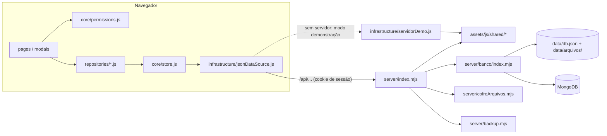
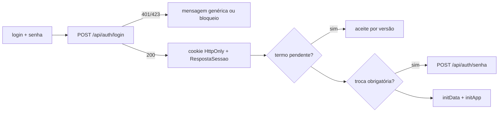

# Arquitetura Atual — PEP (FCMSCSP)

Estado atual do repositório (novembro de 2026, versão 1.2.0). O histórico das mudanças está em [REFACTORING_REPORT.md](./REFACTORING_REPORT.md); o estado anterior à primeira refatoração, em [FRONTEND_AUDIT.md](./FRONTEND_AUDIT.md).

## Visão geral



- **Navegador:** SPA em ES Modules nativos, sem framework e sem build. Desenha as telas e decide quais botões mostrar.
- **Servidor Node** (`server/index.mjs`): serve os arquivos estáticos e a API. Autentica, aplica o escopo de cada papel, confere cada gravação, carimba autoria e horário, grava a trilha de auditoria, cifra os arquivos anexados e gera os backups.
- **Regras compartilhadas** (`assets/js/shared/`): o mesmo código roda no servidor e no modo demonstração, para as duas versões se comportarem igual.
- **Banco:** arquivo JSON (padrão) ou MongoDB, escolhido por `PEP_BANCO`, com a mesma interface.

## Stack

- HTML + CSS + JavaScript (ES Modules nativos, sem bundler/transpiler)
- Node.js 20+ sem framework; driver `mongodb` opcional
- Chart.js (CDN) para gráficos do dashboard; Bootstrap Icons + Google Fonts (CDN)
- `sessionStorage` só para lembrar a página aberta; a sessão em si é um cookie HttpOnly
- `node:test`, ESLint e Prettier

## Estrutura de diretórios

```
index.html
assets/
  css/styles.css
  js/
    main.js                  # entry point: importa tudo, expõe em window, faz boot()
    core/
      auth.js                # sessão, login/logout, router SPA (navigate), termo e troca de senha
      store.js               # estado em memória; carrega e grava pela API
      permissions.js         # can(action, resource) / canAccessPage(page)
      paginacao.js           # paginar() e controles de página das listas
      clinico.js, idService.js, dateService.js, enums.js, config.js, logger.js, utils.js
    domain/models.js         # JSDoc typedefs
    shared/                  # regras do servidor (também usadas no modo demonstração)
      politica.js            # escopo de leitura e conferência das gravações
      auditoria.js           # eventos, encadeamento por hash, filtros, CSV
      usuarios.js            # cadastro, edição, redefinição de senha, acesso temporário do paciente
      arquivos.js            # tipos aceitos, detecção pelo conteúdo, nome seguro, base64
      configuracao.js        # segurança, privacidade, guarda, backup, dados institucionais
      regrasAcesso.js        # política de senha, bloqueio
      sha256.js
    infrastructure/
      jsonDataSource.js      # chamadas à API; detecta servidor ou modo demonstração
      servidorDemo.js        # API simulada no navegador (localStorage + IndexedDB)
    repositories/            # patient, user, appointment, clinical, document, notification,
                             # accessRequest, absence, audit
    pages/                   # dashboard, pacientes, agenda, acesso, notificacoes, privacidade
    modals/                  # modals.js, registros.js (documentos emitidos, comunicações),
                             # agendamentos.js (agenda e pedidos dos pacientes)
server/
  index.mjs                  # rotas, fila de requisições, estáticos, backup agendado
  security.mjs               # scrypt, sessões em memória, bloqueio
  cofreArquivos.mjs          # AES-256-GCM dos arquivos anexados
  backup.mjs                 # backups cifrados
  jsonDb.mjs                 # estrutura do conjunto de dados, gravação atômica do JSON
  banco/index.mjs            # escolhe o banco (PEP_BANCO)
  banco/json.mjs             # data/db.json + data/arquivos/
  banco/mongodb.mjs          # MongoDB
  audit.mjs, policy.mjs, config.mjs   # reexportam assets/js/shared/
scripts/                     # gerar-agenda, restaurar-backup, migrar-para-mongodb
data/                        # seed.json, instituicao.exemplo.json (+ dados em uso, fora do git)
tests/                       # node:test
```

## Inicialização (boot)

```mermaid
sequenceDiagram
    participant Main as main.js
    participant Auth as core/auth.js
    participant DS as jsonDataSource.js
    participant Srv as Servidor (ou servidorDemo)
    participant Store as core/store.js

    Main->>Auth: boot()
    Auth->>DS: detectarModo() via GET /api/institucional
    Note over DS: resposta JSON → "servidor"; senão → "demo"
    Auth->>Srv: GET /api/auth/me (cookie)
    alt sessão válida
        Auth->>Auth: termo pendente? troca de senha obrigatória?
        Auth->>Store: initData()
        Store->>Srv: GET /api/data (só o escopo do papel)
        Auth->>Auth: controle de inatividade + initApp(página salva)
    else 401
        Note over Auth: mostra a tela de login (e o motivo, se foi inatividade)
    end
```

## Login



A troca obrigatória (senha inicial ou provisória da equipe) é uma tela bloqueante, e o servidor a garante: enquanto estiver pendente, as demais rotas respondem `403` com `motivo: "troca_senha"`. O paciente não passa por ela; o login dele é recusado quando o acesso temporário vence, e a sessão aberta cai com `motivo: "acesso_expirado"`.

A senha só trafega no login (e na troca); o servidor guarda hash scrypt e nunca devolve senha ou hash. A exceção é a senha temporária do paciente, gerada pelo servidor e devolvida uma única vez ao técnico na resposta de `POST /api/pacientes/:pid/acesso-temporario`.

## Leitura e gravação

```mermaid
sequenceDiagram
    participant UI as Tela
    participant Store as store.js
    participant DS as jsonDataSource.js
    participant Srv as server/index.mjs
    participant Pol as shared/politica.js
    participant DB as banco (JSON ou MongoDB)

    UI->>Store: altera arrays + saveData()
    Store->>DS: gravarDataset() (agrupa alterações próximas)
    DS->>Srv: PUT /api/data
    Srv->>DB: ler()
    Srv->>Pol: aplicarAlteracoes(dados, usuário, entrada)
    alt alguma regra violada
        Srv-->>DS: 403 { erro } (nada é gravado)
    else ok
        Srv->>DB: gravar() (JSON: arquivo inteiro; MongoDB: só documentos alterados)
        Srv-->>DS: { ok, data: escopo atualizado }
        DS->>Store: loadDataset(data) (autoria, horários e assinaturas do servidor)
    end
```

- O servidor lê o conjunto de dados inteiro a cada requisição e atende uma requisição por vez (fila). Por isso roda **uma instância por banco**.
- O envio de arquivo usa uma rota própria (`POST /api/pacientes/:pid/documentos`): o servidor confere o arquivo, cria o registro pelas mesmas regras, grava o conteúdo cifrado em `arquivos.salvar()` e carimba o metadado. O download (`GET .../arquivo`) decifra, confere o SHA-256 e audita.
- A trilha de auditoria só é gravada pelo servidor; a tela informa apenas leituras e impressões (`POST /api/audit/evento`).

## Modo demonstração

Sem servidor (GitHub Pages, Live Server), `jsonDataSource.js` encaminha as chamadas para `servidorDemo.js`, que roda as mesmas regras de `assets/js/shared/` no navegador. Os dados partem de `data/seed.json` e ficam no `localStorage`; os arquivos anexados ficam no IndexedDB. Não há segurança real nesse modo.

## Autorização

- **Servidor:** `pacientesPermitidos()`, `escopo()` e `aplicarAlteracoes()` em `shared/politica.js`; gestão de usuários em `shared/usuarios.js`; rotas de usuários e auditoria exigem o técnico. É o que protege os dados.
- **Tela:** `can()` e `canAccessPage()` em `core/permissions.js` decidem botões e páginas. Ver [PERMISSIONS_MATRIX.md](./PERMISSIONS_MATRIX.md).

## Paginação

`core/paginacao.js` pagina na tela as listas de pacientes (20 por página), equipe (12, com busca) e acesso temporário dos pacientes (10). A trilha de auditoria é paginada no servidor (`GET /api/audit?pagina=&porPagina=`, 50 por página). As demais listas recebem todo o escopo do usuário.

## Estado no navegador

O estado vive em variáveis exportadas de `core/store.js` (`USERS`, `PACIENTES`, `ANAMNESES`, `EVOLUCOES`, `AGENDAMENTOS`, `DOCUMENTOS`, `REGISTRO_DOCUMENTAL`, `COMPARTILHAMENTOS`, `FALTAS`, `SOLICITACOES_AGENDAMENTO`, `NOTIFICACOES`, `ACESSO_PACIENTE`) mais `currentUser` em `core/auth.js`. Depois de cada gravação, o estado é substituído pelo escopo devolvido pelo servidor.

## Entidades

Ver [DOMAIN_MODEL.md](./DOMAIN_MODEL.md) (campos e regras) e [DATABASE_MONGODB.md](./DATABASE_MONGODB.md) (coleções).

## Eventos e comunicação entre módulos

Não há event bus. A comunicação é por import direto (ES Modules). Os eventos são:
- eventos DOM nativos, via `addEventListener` (handlers estáticos do `index.html`) ou atributos inline `onclick`/`oninput` no HTML gerado ([FRONTEND_AUDIT.md](./FRONTEND_AUDIT.md), item 12);
- eventos de `window` disparados por `jsonDataSource.js`: `pep:unauthorized`, `pep:save-error`, `pep:saved`, `pep:synced`;
- atualização periódica do contador do sininho, iniciada por `initApp()`.

## Pontos de acoplamento conhecidos

- `auth.js` ↔ `store.js`, `auth.js` ↔ `dashboard.js`, `auth.js` ↔ `permissions.js`: dependências circulares intencionais e seguras (a referência só é lida dentro de funções).
- `main.js` conhece todas as páginas e modais para expô-los em `window` (composition root).
- O servidor importa regras de `assets/js/shared/`. Esses arquivos não podem depender do DOM nem de nada que só exista no navegador.
