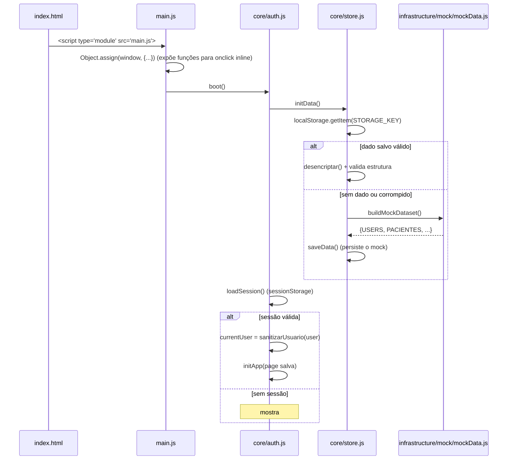
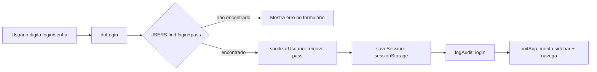
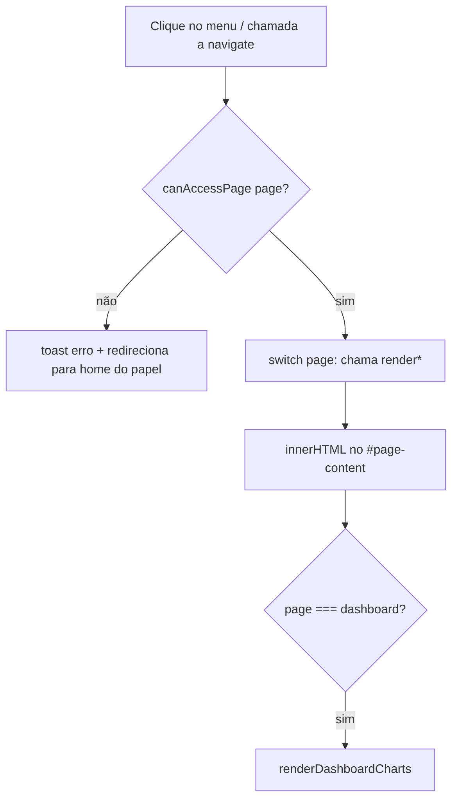
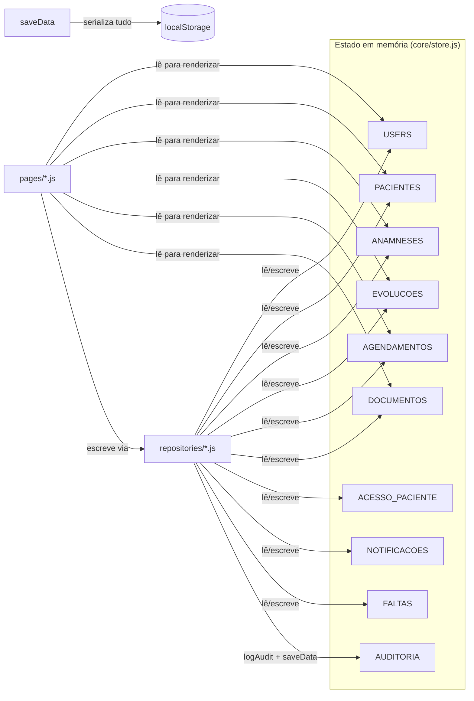
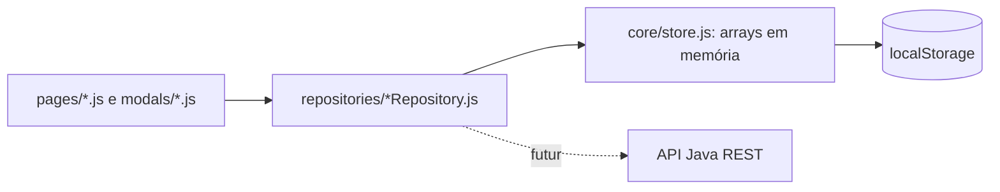
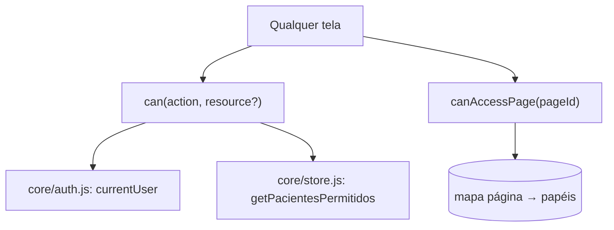
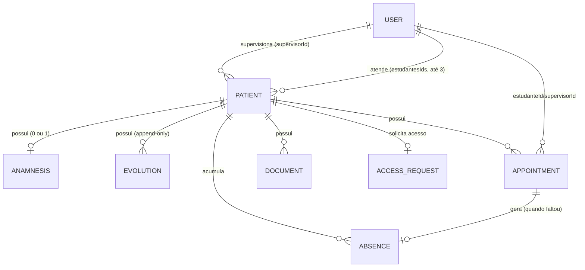

# Arquitetura Atual — PEP (FCMSCSP)

Este documento descreve a arquitetura do frontend **depois** da refatoração descrita em [REFACTORING_REPORT.md](./REFACTORING_REPORT.md) — ou seja, o estado atual do repositório. Para o estado anterior à refatoração, ver o histórico do git e [FRONTEND_AUDIT.md](./FRONTEND_AUDIT.md).

## Stack

- HTML + CSS + JavaScript (ES Modules nativos, sem bundler/transpiler)
- `localStorage`/`sessionStorage` para persistência
- Chart.js (CDN) para gráficos do dashboard
- Bootstrap Icons + Google Fonts (CDN)
- Sem framework de UI (sem React/Vue) e sem build step

## Estrutura de diretórios

```
index.html
assets/
  css/
    styles.css              # design tokens + todas as telas (ver nota abaixo)
  js/
    main.js                 # entry point: importa tudo, expõe em window, faz boot()
    core/
      auth.js                # sessão, login/logout, router SPA (navigate)
      store.js                # estado em memória (arrays) + persistência localStorage
      permissions.js          # can(action, resource) / canAccessPage(page)
      idService.js             # geração de IDs (UUID / sequencial)
      dateService.js           # formatação e cálculo de datas
      enums.js                 # constantes de status/papéis/tipos
      config.js                 # configuração (API_BASE_URL, feature flags)
      logger.js                  # abstração sobre console.*
      utils.js                    # toast, busca global, auto-logout
    domain/
      models.js                   # JSDoc typedefs das entidades de domínio
    infrastructure/
      mock/
        mockData.js                # dataset de demonstração (buildMockDataset())
    repositories/
      patientRepository.js
      userRepository.js
      appointmentRepository.js
      clinicalRepository.js         # anamnese + evolução
      documentRepository.js
      notificationRepository.js
      accessRequestRepository.js
      absenceRepository.js
      auditRepository.js
    pages/
      dashboard.js
      pacientes.js
      agenda.js
      acesso.js
      notificacoes.js
    modals/
      modals.js
```

> **Nota sobre `styles.css`:** decidimos conscientemente **não** dividir o CSS em múltiplos arquivos nesta etapa. Ver [ARCHITECTURE_TARGET.md](./ARCHITECTURE_TARGET.md) para a justificativa.

## Fluxo de inicialização (boot)



## Fluxo de autenticação



A senha **nunca** fica em `currentUser` após o login — `sanitizarUsuario()` a remove antes de atribuir. Ela só existe em memória durante a comparação em `USERS.find()`.

## Fluxo de navegação (SPA)



`navigate()` (em `core/auth.js`) é o roteador central. A guarda de página (`canAccessPage`, adicionada nesta refatoração) impede que uma página seja renderizada para um papel sem permissão mesmo que `navigate()` seja chamada diretamente (ex.: console do navegador).

## Gerenciamento de estado

Não há um "store" único no sentido Redux/Vuex. O estado vive em variáveis `let` exportadas de `core/store.js` (`USERS`, `PACIENTES`, `ANAMNESES`, `EVOLUCOES`, `AGENDAMENTOS`, `DOCUMENTOS`, `AUDITORIA`, `ACESSO_PACIENTE`, `NOTIFICACOES`, `FALTAS`) mais `currentUser`/`currentPage` em `core/auth.js`. Todo o array é persistido de uma vez em `saveData()`.



## Camada de repositórios (nova nesta refatoração)



Cada repositório expõe operações no vocabulário de domínio (`list`, `getById`, `create`, `update`, `cancel`, `approve`...) em vez de expor os arrays crus. Nem todo o código de leitura foi migrado para passar pelos repositórios (renderização de listas continua lendo os arrays diretamente via `store.js` — é leitura simples, sem regra de negócio); a migração se concentrou nos pontos de **escrita** (criar, atualizar, aprovar), que são onde regra de negócio + auditoria + geração de ID se concentram.

## Autorização (nova nesta refatoração)



`core/permissions.js` é a única fonte de verdade sobre "quem pode fazer o quê" no frontend. Ver [PERMISSIONS_MATRIX.md](./PERMISSIONS_MATRIX.md) para a matriz completa e o aviso de que isto é autorização de UX, não segurança real (ver [SECURITY_BACKEND_REQUIREMENTS.md](./SECURITY_BACKEND_REQUIREMENTS.md)).

## Entidades e relacionamentos



Ver [DOMAIN_MODEL.md](./DOMAIN_MODEL.md) para os campos completos de cada entidade.

## Eventos e comunicação entre módulos

Não há um event bus. A comunicação é por import direto de funções (ES Modules) — o grafo de dependências é resolvido estaticamente pelo navegador. Os únicos "eventos" no sentido de pub/sub são:
- Eventos DOM nativos (`click`, `keydown`, `input`) — capturados via `addEventListener` (para os handlers estáticos do `index.html`, migrados nesta refatoração) ou via atributos inline `onclick`/`oninput` (para o HTML gerado dinamicamente — ver [FRONTEND_AUDIT.md](./FRONTEND_AUDIT.md), item 12).
- `setInterval(_updateNotifBadge, 60000)` em `pages/notificacoes.js` — atualização periódica do contador de notificações do sininho.

## Pontos de acoplamento conhecidos

- `auth.js` ↔ `store.js`, `auth.js` ↔ `dashboard.js`, `auth.js` ↔ `permissions.js`: dependências circulares intencionais (ver [FRONTEND_AUDIT.md](./FRONTEND_AUDIT.md), seção "Não encontrado"). Seguras porque a referência circular só é lida dentro de corpos de função, nunca na avaliação de topo do módulo.
- `main.js` conhece **todas** as páginas e modais para poder expô-los em `window` — é o único arquivo com esse conhecimento total do sistema, por design (é o "composition root" da aplicação).
