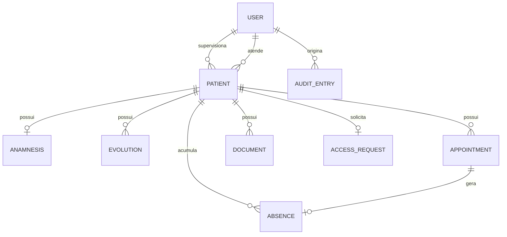

# Modelo de Domínio — PEP (FCMSCSP)

Entidades do sistema, seus campos, relacionamentos, regras de negócio e ciclo de vida. Espelha `assets/js/domain/models.js` (JSDoc) e é a base para [DATABASE_MONGODB.md](./DATABASE_MONGODB.md) e [API_DTOS.md](./API_DTOS.md).

---

## User (Usuário)

**Propósito:** representa qualquer pessoa que acessa o sistema — psicólogo técnico, supervisor, estudante ou paciente.

| Campo | Tipo | Obrigatório | Observação |
|---|---|---|---|
| id | number | sim | numérico sequencial no mock; será substituído pelo ID do backend |
| login | string | sim | único |
| pass | string | sim | texto puro **apenas no mock**; nunca deve chegar assim ao backend real (ver [SECURITY_BACKEND_REQUIREMENTS.md](./SECURITY_BACKEND_REQUIREMENTS.md)) |
| nome | string | sim | |
| papel | enum | sim | `tecnico` \| `supervisor` \| `estudante` \| `paciente` |
| avatar | string | sim | iniciais, derivadas do nome |
| color | string | sim | cor hex do avatar |

**Regras de negócio:**
- Um login não pode se repetir (`userRepository.create` rejeita duplicado).
- A senha nunca fica em memória fora do momento da comparação de login — `sanitizarUsuario()` remove `pass` antes de atribuir a `currentUser`.
- Um usuário com papel `paciente` é, na prática, também referenciado como `Patient` com o mesmo `id` (ver nota em `Patient`).

**Ciclo de vida:** criado por um técnico (`user.create`); não há fluxo de edição nem exclusão no frontend atual (dívida documentada em [FUTURE_IMPROVEMENTS.md](./FUTURE_IMPROVEMENTS.md)).

**Auditoria:** `login`, `cadastro` (criação de usuário).

---

## Patient (Paciente)

**Propósito:** o caso clínico acompanhado pelo Serviço-Escola.

| Campo | Tipo | Obrigatório | Observação |
|---|---|---|---|
| id | number | sim | ⚠️ ver nota abaixo sobre relação com `User.id` |
| nome | string | sim | |
| cpf | string | sim | validado (algoritmo de dígito verificador) e único |
| nascimento | string (ISO date) | não | default `2000-01-01` se omitido |
| telefone | string | não | |
| email | string | não | validado por formato se preenchido |
| estudantesIds | number[] | não | até 3 IDs de `User` com papel `estudante` |
| supervisorId | number | sim | ID de `User` com papel `supervisor` |
| status | enum | sim | `ativo` \| `inativo` |
| cor | string | sim | cor institucional fixa `#1b5e20` |
| ini | string | sim | iniciais, derivadas do nome |

**⚠️ Não assuma que `Patient.id === User.id` como regra geral.** No dataset de demonstração, o paciente "de teste" (login `paciente/1234`) tem `id: 200` tanto como `User` quanto como `Patient`, para que o login funcione — mas isso é uma coincidência do mock, não uma regra de modelagem. No domínio real, um paciente pode existir sem nunca ter recebido uma conta de acesso (fluxo de "Acesso do Paciente" trata exatamente disso: o paciente só ganha login quando uma solicitação de acesso é aprovada). O backend deve tratar `User` e `Patient` como coleções independentes, ligadas por uma referência explícita, não por igualdade de ID.

**Regras de negócio:**
- CPF deve ser válido (dígito verificador) e único entre pacientes ativos.
- RBAC: quem pode **ver** um paciente depende do papel de quem pergunta — ver [PERMISSIONS_MATRIX.md](./PERMISSIONS_MATRIX.md).
- Ao ser criado, inicializa automaticamente coleções vazias de evolução e documentos.
- Ao acumular **2 faltas injustificadas**, gera uma notificação de "troca de paciente recomendada" para o técnico (ver `Absence`).
- Uma "troca de paciente" (`executarTrocaPaciente`) marca o paciente como `inativo` e cancela todos os agendamentos futuros confirmados.

**Ciclo de vida:** `ativo` → (2 faltas injustificadas) → notificação de troca → (técnico confirma) → `inativo`. Não há reativação nem exclusão no frontend atual.

**Auditoria:** `cadastro` (criação/edição), `troca` (troca de caso).

---

## Anamnesis (Anamnese)

**Propósito:** entrevista clínica inicial. No máximo uma por paciente.

| Campo | Tipo | Obrigatório | Observação |
|---|---|---|---|
| queixa | string | sim | única obrigatória |
| historia | string | não | |
| historico_medico | string | não | |
| medicamentos | string | não | |
| contexto | string | não | |
| hipoteses | string | não | plano terapêutico |
| status | enum | sim | `rascunho` \| `finalizada` |
| rascunho | boolean | sim | espelha `status === "rascunho"` |
| criadoPor | string | não | nome de quem criou |
| criadoEm / atualizadoEm | string (ISO datetime) | não | |

**Regra de negócio crítica (exigência do CRP):** uma anamnese com `status: "finalizada"` é **imutável**. Uma tentativa de salvar novamente como `finalizada` é rejeitada com erro explícito (`clinicalRepository.saveAnamnesis`). Só é possível editar enquanto `status === "rascunho"`.

**Auditoria:** `anamnese` (toda alteração, incluindo rascunhos).

---

## Evolution (Evolução)

**Propósito:** registro de cada sessão/atendimento. Lista append-only por paciente.

| Campo | Tipo | Obrigatório | Observação |
|---|---|---|---|
| id | number | sim | |
| num | number | sim | sequencial dentro do prontuário do paciente (1, 2, 3...) |
| data | string ("AAAA-MM-DD HH:mm") | sim | |
| autor | string | sim | nome de quem registrou |
| papel | enum | sim | papel de quem registrou, no momento do registro |
| tipo | enum | sim | `atendimento` \| `supervisao` |
| conteudo | string | sim | texto livre; templates SOAP/Acolhimento disponíveis na UI só como ponto de partida |
| tags | string[] | não | livres, definidas pelo autor |

**Regra de negócio crítica (exigência do CRP): uma evolução nunca é editada nem apagada.** Não existe (e não deve existir) endpoint/função de update ou delete para evolução — apenas `create`.

**Auditoria:** `evolucao` (toda criação).

---

## Appointment (Agendamento)

**Propósito:** uma sessão marcada entre paciente e estudante/supervisor.

| Campo | Tipo | Obrigatório | Observação |
|---|---|---|---|
| id | number | sim | |
| pacienteId | number | sim | |
| estudanteId | number | não | pode ser nulo (ex.: sessão de supervisão sem estudante) |
| supervisorId | number | não | |
| data | string (ISO date) | sim | |
| hora | string ("HH:mm") | sim | |
| local | string | sim | |
| modalidade | enum | sim | `presencial` \| `online` |
| status | enum | sim | `confirmado` \| `pendente` \| `cancelado` \| `faltou` |

**Regras de negócio:**
- Conflito de horário: não pode haver dois agendamentos para o mesmo par (paciente, estudante) na mesma data+hora, exceto se um deles estiver cancelado. Dois estudantes diferentes **podem** ter agendamentos no mesmo horário (ex.: consultórios diferentes).
- Cancelamento é permanente (não há "reagendar" — cria-se um novo agendamento).
- `faltou` é definido por `registrarFalta()`, que também cria uma entrada em `Absence`.

**Ciclo de vida:** `confirmado` → `cancelado` (irreversível) OU `confirmado` → `faltou` (gera `Absence`, que pode depois ser `justificada`, mas o agendamento continua `faltou`).

**Auditoria:** `agenda` (criação, edição, cancelamento).

---

## DocumentMeta (Documento)

**Propósito:** metadado de um arquivo anexado ao prontuário. **O upload é 100% simulado** — não existe armazenamento real de binário no frontend.

| Campo | Tipo | Obrigatório | Observação |
|---|---|---|---|
| id | string | sim | prefixo `d` + UUID |
| nome | string | sim | |
| tipo | enum | sim | `pdf` \| `img` \| `docx` |
| tamanho | string | sim | metadado de demonstração, determinístico (hash do nome) — nunca aleatório |
| data | string (ISO date) | sim | |
| autor | string | sim | |

**Nota importante para o backend:** MongoDB não deve ser assumido automaticamente como o lugar de armazenar o binário do arquivo em si — ver [DATABASE_MONGODB.md](./DATABASE_MONGODB.md) e [SECURITY_BACKEND_REQUIREMENTS.md](./SECURITY_BACKEND_REQUIREMENTS.md).

**Auditoria:** `export` (nome mantido do código original — cobre upload e exportação de PDF; renomear para `document.upload` é recomendado no backend, ver [AUDIT_LOG_SPEC.md](./AUDIT_LOG_SPEC.md)).

---

## AccessRequest (Solicitação de Acesso do Paciente)

**Propósito:** controla quando um paciente ganha acesso de leitura ao próprio prontuário digital (tela "Acesso do Paciente").

| Campo | Tipo | Obrigatório | Observação |
|---|---|---|---|
| id | string | sim | UUID |
| pacienteId | number | sim | |
| nome | string | sim | |
| status | enum | sim | `pendente` \| `liberado` |
| solicitacao | string (ISO date) | sim | |
| liberacao | string (ISO date) | não | preenchido só quando aprovado |
| protocolo | string | sim | `PROT-AAAA-XXXXXXXX` |

**Regra de negócio:** só um técnico pode aprovar (`access.manage`). Uma vez `liberado`, o paciente pode ver seu próprio prontuário resumido via `renderMeuProntuario()`.

**Auditoria:** `cadastro` (tanto a criação da solicitação quanto sua liberação).

---

## Notification (Notificação)

**Propósito:** alertas do "sininho", calculados em parte dinamicamente e em parte persistidos.

| Campo | Tipo | Obrigatório | Observação |
|---|---|---|---|
| id | string | sim | |
| tipo | enum | sim | `evolucao_pendente` \| `troca_solicitada` \| `troca_realizada` \| `falta_registrada` |
| pacienteId | number | não | |
| estudantesIds | number[] | não | destinatários, quando aplicável |
| icone / cor | string | sim | apresentação |
| titulo / desc | string | sim | |
| tipoAcao | string | não | `OPEN_PRONTUARIO` \| `CONFIRMAR_TROCA` — usado por um dispatcher seguro (sem `eval`), ver `acionarNotif()` |
| lida | boolean | sim | |
| ts | string | sim | |

**Regra de negócio:** `evolucao_pendente` é **calculada em tempo real** a cada leitura do painel (não fica persistida até ser lida) — compara o horário da consulta com o relógio atual. As demais são persistidas no momento em que o evento ocorre.

---

## Absence (Falta)

**Propósito:** registro de uma falta do paciente em um atendimento agendado.

| Campo | Tipo | Obrigatório | Observação |
|---|---|---|---|
| id | string | sim | prefixo `falta_` + UUID |
| agId | number | sim | referência ao `Appointment` |
| pacienteId | number | sim | |
| data / hora | string | sim | copiados do agendamento no momento do registro |
| justificada | boolean | sim | default `false` |
| estudantesIds | number[] | sim | copiados do paciente no momento do registro |
| registradoPor | string | sim | |
| ts | string (ISO datetime) | sim | |

**Regra de negócio:** ao atingir **2 faltas injustificadas** para o mesmo paciente, dispara notificação `troca_solicitada` para o técnico (uma única vez, não repete enquanto a notificação anterior não for tratada).

**Auditoria:** `falta` (registro e justificativa).

---

## AuditEntry (Trilha de Auditoria)

**Propósito:** log imutável de ações relevantes. Nunca editado nem apagado pelo frontend.

| Campo | Tipo | Obrigatório |
|---|---|---|
| id | string | sim |
| tipo | string | sim |
| ator | string | sim |
| acao | string | sim |
| obj | string | não |
| ts | string | sim |
| dot | string | sim (cor do indicador visual) |

Ver [AUDIT_LOG_SPEC.md](./AUDIT_LOG_SPEC.md) para o que o backend deve auditar além do que o frontend já registra.
