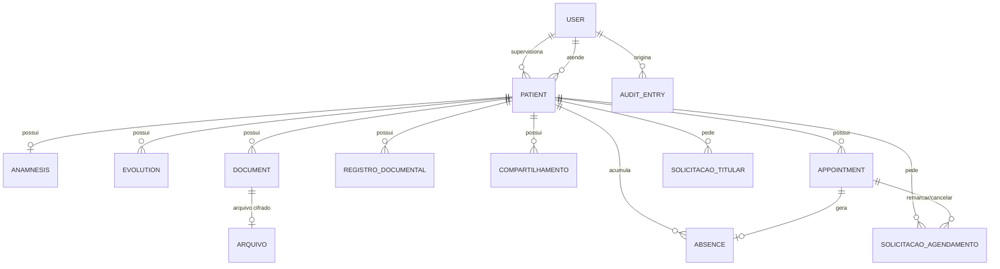

# Modelo de Domínio — PEP (FCMSCSP)

Entidades do sistema, seus campos, relacionamentos, regras de negócio e ciclo de vida, como estão hoje nos dados (`data/seed.json`, `data/db.json` ou MongoDB). As regras de gravação ficam em `assets/js/shared/politica.js` e valem no servidor e no modo demonstração. `assets/js/domain/models.js` tem os typedefs JSDoc usados pelas telas, mas está desatualizado em alguns campos; em caso de dúvida, vale este documento e o código de `shared/`.

Nome da coleção no conjunto de dados entre parênteses. Campos carimbados pelo servidor (autoria, horários, assinatura) são ignorados se vierem do navegador.

---

## User — Usuário (`USERS`)

Qualquer pessoa que acessa o sistema: técnico (responsável técnico e administrador), supervisor, estudante ou paciente.

| Campo | Tipo | Observação |
|---|---|---|
| id | number | Equipe: sequencial abaixo dos ids de paciente. Paciente: **o mesmo id do prontuário**. |
| login | string | Único, sem diferenciar maiúsculas; 3 a 40 letras, números, `.`, `-` ou `_` |
| senha, senhaAnterior | string | Hash scrypt com salt. Nunca sai do servidor. |
| nome | string | Paciente: nome social ou nome do cadastro |
| papel | enum | `tecnico` \| `supervisor` \| `estudante` \| `paciente` |
| crp | string \| null | Obrigatório para técnico e supervisor (`CRP 06/123456`) |
| matricula | string \| null | Obrigatória para estudante |
| avatar, color | string | Iniciais e cor |
| ativo | boolean | Usuários são inativados, nunca excluídos |
| seguranca | objeto | `tentativasFalhas`, `bloqueadoAte`, `ultimoAcesso`, `trocaObrigatoria`, `senhaAlteradaEm`, `senhaRedefinidaEm` |
| termos | objeto | Aceite do aviso/termo por versão: `{ "2026-10": "<data>" }` |
| acessoTemporario, acessoExpiraEm, acessoGeradoEm, acessoGeradoPorId | | Só no paciente: marca de acesso temporário, fim da validade (ISO), quando e por quem foi gerado ou renovado |
| criadoEm, criadoPorId, atualizadoEm | | Carimbados pelo servidor |

**Regras** (`shared/usuarios.js`):
- Só o técnico cadastra, edita, redefine senha, desbloqueia e inativa, sempre confirmando a própria senha.
- Equipe: o técnico define qualquer senha inicial ou provisória com pelo menos 4 caracteres (`SEGURANCA.senhaProvisoriaMinimo`), sem a política de senha forte. Ela obriga a troca no próximo acesso: uma tela bloqueante exige criar senha própria (8+ caracteres, letras e números, sem nome ou login, diferente da atual), e até lá o servidor recusa as demais rotas (`403`, `motivo: "troca_senha"`). A redefinição desbloqueia a conta e encerra as sessões.
- Mudar papel ou login encerra as sessões do usuário. A troca de papel é recusada enquanto ele for supervisor ou estagiário de algum caso (transfira os casos antes) e quando deixaria o sistema sem técnico ativo.
- Acesso temporário do paciente: nem todo paciente tem. Quando ele pede o prontuário (presencialmente, por telefone ou e-mail), o técnico imprime o prontuário ou gera o acesso (`POST /api/pacientes/:pid/acesso-temporario`). O sistema cria o login `pac<id do caso>` e uma senha aleatória de 10 caracteres, mostrada uma única vez; vale por `acessoPortal.validadeDias` (7 dias provisórios enquanto a instituição não definir). Gerar de novo troca a senha e encerra as sessões. Vencido o prazo (ou sem `acessoExpiraEm`), o login é recusado e a sessão aberta cai. Não há troca obrigatória de senha nem redefinição de senha para o paciente; encerrar o acesso antes do prazo é inativar. O cadastro por `POST /api/usuarios` com papel `paciente` é recusado. Um por paciente; só o login é editável; nome e dados vêm do cadastro do paciente.
- O usuário paciente só consulta: qualquer gravação dele é recusada.

**Auditoria:** `usuario_criado`, `usuario_atualizado`, `senha_redefinida`, `acesso_temporario_gerado`, `usuario_desbloqueado`, `usuario_inativado`, `usuario_reativado`, `senha_alterada`, `termo_aceito`.

---

## Patient — Paciente (`PACIENTES`)

O caso clínico acompanhado pelo Serviço-Escola.

| Campo | Tipo | Observação |
|---|---|---|
| id | number | Também é o id do usuário de acesso temporário do paciente, se houver |
| nome, nomeSocial | string | |
| cpf | string | Único entre pacientes |
| nascimento, telefone, email | string | |
| contatoEmergencia | objeto | `nome`, `vinculo`, `telefone` |
| responsavel | objeto \| null | Obrigatório para menor de idade, com CPF válido |
| supervisorId | number | Usuário com papel `supervisor` |
| estudantesIds | number[] | Até 3 usuários com papel `estudante` |
| status | enum | `ativo` \| `inativo` (encerrado) |
| encerramento | objeto \| null | Motivo, encaminhamento; `registradoPorId`, `registradoEm` carimbados |
| consentimentos | objeto[] | `tipo`, `versao`, `data`, `aceito`, `assinadoPor`; revogação com `revogadoEm` e `motivoRevogacao` |
| cor, ini | string | Apresentação |
| cadastradoEm, cadastradoPorId | | Carimbados |

**Regras:**
- Só o técnico cadastra e altera o cadastro, inclusive a troca de supervisor e de estagiários (transferência do caso). O servidor confere que o supervisor e os estagiários existem com o papel certo.
- O encerramento pode ser registrado pelo técnico ou pelo supervisor do caso e não muda depois.
- Consentimentos: a lista só cresce; revogar exige motivo e não apaga o registro.
- Caso encerrado não recebe novos agendamentos.
- Ao acumular **2 faltas injustificadas**, a tela gera uma notificação `troca_solicitada` para o técnico.

**Auditoria:** `paciente_criado`, `paciente_atualizado`, `caso_encerrado`, `consentimento_registrado`, `consentimento_revogado`.

---

## Anamnesis — Avaliação de demanda (`ANAMNESES`, uma por paciente)

| Campo | Tipo | Observação |
|---|---|---|
| queixa, historia, historico_medico, medicamentos, contexto, hipoteses, objetivos | string | `objetivos` é obrigatório para finalizar |
| status | enum | `rascunho` \| `finalizada` |
| rascunho | boolean | Espelha o status |
| criadoPor, criadoPorId, criadoEm, atualizadoEm, atualizadoPorId | | Carimbados |
| assinatura | objeto | Na finalização (ver "Assinatura") |
| validacao | objeto | `pendente` se finalizada por estudante; `validada` com quem co-assinou |

**Regra crítica (Res. CFP 001/2009):** finalizada não muda; a única alteração aceita é a co-assinatura pelo supervisor do caso ou pelo técnico. O paciente só vê a avaliação finalizada.

**Auditoria:** `anamnese_salva`, `anamnese_finalizada`, `evolucao_validada` (co-assinatura).

---

## Evolution — Evolução (`EVOLUCOES[pacienteId]`)

| Campo | Tipo | Observação |
|---|---|---|
| id | number \| string | |
| num | number | Sequencial no prontuário, definido pelo servidor |
| data | string | `AAAA-MM-DD HH:mm` |
| tipo | enum | `atendimento` \| `supervisao` |
| conteudo | string | Obrigatório |
| tags | string[] | |
| autorId, autor, papel, registradoEm | | Carimbados |
| assinatura, validacao | objeto | Ver "Assinatura" |
| versoes | objeto[] | Versões anteriores, com `substituidaEm` e `justificativa` |

**Regras:** nunca é apagada. Depois de criada, só aceita co-assinatura (supervisor do caso ou técnico) ou **retificação pelo próprio autor**, com justificativa de pelo menos 10 caracteres; a versão anterior fica em `versoes` e continua visível. O paciente só vê evoluções validadas.

**Auditoria:** `evolucao_criada`, `evolucao_validada`, `evolucao_retificada`.

---

## Document — Documento (`DOCUMENTOS[pacienteId]`)

Dois tipos de registro na mesma coleção: **anexados** (arquivo recebido ou digitalizado) e **emitidos** pelo serviço (Res. CFP 06/2019).

| Campo | Tipo | Observação |
|---|---|---|
| id | string | Anexados pela rota de envio: `d_<uuid>` |
| nome | string | Nome do arquivo (limpo pelo servidor) |
| tipo | enum | `pdf` \| `png` \| `jpg` \| `docx`, detectado pelo conteúdo |
| categoria | enum | `termo` \| `diagnostico_externo` \| `material_teste` \| `outro` \| `emitido` |
| compartimento | enum | `prontuario` \| `restrito` (material de teste) |
| titulo, data | string | |
| origem, resumo | | Em `diagnostico_externo`: profissional e CRP obrigatórios, instituição, data de emissão |
| arquivo | ArquivoAnexado \| ausente | Só nos anexados com arquivo digital; ver abaixo |
| autor, autorId, registradoEm | | Carimbados |
| modalidade, finalidade, destinatario, solicitante, validade, local, conteudo, dataEmissao | | Emitidos: declaração, atestado, relatório, laudo, parecer |
| assinaturas, validacao | | Emitidos; estudante precisa de co-assinatura |
| devolutiva, entrega | objeto | Registradas uma vez, não mudam |

**ArquivoAnexado** (`documento.arquivo`), carimbado só pela rota `POST /api/pacientes/:pid/documentos`:

| Campo | Tipo | Observação |
|---|---|---|
| id | string | `a_<uuid>`; chave do conteúdo cifrado (`data/arquivos/<id>.bin` ou coleção `arquivos`) |
| nome | string | Sem caminho nem caracteres reservados, com a extensão do tipo real |
| mime | string | `application/pdf`, `image/png`, `image/jpeg` ou o MIME do .docx |
| tamanho | number | Bytes do original (até 10 MB) |
| sha256 | string | Do original; conferido a cada download |
| enviadoEm | string | ISO |

**Regras:**
- Só inclusão. Depois, só co-assinatura, devolutiva e entrega.
- O vínculo com o arquivo nunca vem do navegador: `PUT /api/data` descarta `arquivo` (e o antigo `tamanho`), para que ninguém aponte um registro para o arquivo de outro paciente.
- O conteúdo é gravado cifrado (AES-256-GCM, `server/cofreArquivos.mjs`) e nunca é sobrescrito.
- Download pelo mesmo escopo da leitura. O paciente não vê nem baixa material de teste.
- Os documentos do seed são só registros, sem `arquivo` ("sem arquivo digital").

**Auditoria:** `documento_anexado`, `documento_emitido`, `documento_validado`, `documento_atualizado`, `consulta_documento`, `arquivo_baixado`, `impressao`.

---

## RegistroDocumental (`REGISTRO_DOCUMENTAL[pacienteId]`) e Compartilhamento (`COMPARTILHAMENTOS[pacienteId]`)

- **Registro documental** (Res. CFP 05/2025 art. 17 §2º): supervisões, orientações e registros administrativos. Campos: `tipo`, `data`, `conteudo`, autoria e `assinatura`. Só inclusão, só a equipe. **Nunca é entregue ao paciente.**
- **Compartilhamento:** comunicação de informações a terceiros. Campos: `tipo` (ex.: `encaminhamento_externo`, `notificacao_compulsoria`, `quebra_sigilo`), `data`, `destinatario`, `finalidade`, `fundamento`, `resumo`, `visivelAoTitular`, autoria e `assinatura`. Só inclusão. Quebra de sigilo e notificação compulsória exigem fundamento.

**Auditoria:** `registro_documental_criado`, `consulta_registro_documental`, `compartilhamento_registrado`.

---

## Appointment — Agendamento (`AGENDAMENTOS`)

| Campo | Tipo | Observação |
|---|---|---|
| id | number | |
| pacienteId | number | Não muda depois de criado |
| estudanteId | number \| null | Precisa ser do grupo do caso |
| supervisorId | number | Copiado do caso pelo servidor |
| data | string | `AAAA-MM-DD` |
| hora | string | `HH:mm` |
| local, modalidade | string | |
| status | enum | `confirmado` \| `cancelado` \| `faltou` |
| criadoPorId, criadoEm, atualizadoPorId, atualizadoEm, canceladoPorId, canceladoEm | | Carimbados |

**Regras:**
- **Só o técnico** cria, remarca (altera data, hora, local, estagiário) e cancela. Novo agendamento nasce `confirmado`.
- Conflito: não pode haver dois atendimentos confirmados na mesma data e hora para o **mesmo paciente** ou para o **mesmo estagiário**.
- Caso encerrado não recebe agendamento.
- Supervisor e estudante do caso só mudam `confirmado` → `faltou` (registro de falta).
- Cancelado não muda mais.

**Ciclo de vida:** `confirmado` → `cancelado` (fim) · `confirmado` → `faltou` (gera falta) · `confirmado` → `confirmado` (remarcação pelo técnico).

**Auditoria:** `agendamento_criado`, `agendamento_atualizado` (com `cancelado` ou `faltou` no complemento).

---

## Absence — Falta (`FALTAS`)

| Campo | Tipo | Observação |
|---|---|---|
| id | string | `falta_<uuid>` |
| agId | number | Agendamento |
| pacienteId | number | |
| data, hora | string | Copiados do agendamento |
| estudantesIds | number[] | Grupo do caso no momento do registro |
| registradoPor, registradoPorId, ts | | Carimbados |
| justificada | boolean | |
| justificativa, justificadaPorId, justificadaEm | | Na justificativa |

**Regras:** a equipe do caso registra; depois, só aceita justificativa, feita pelo técnico ou pelo supervisor. Duas faltas injustificadas geram a notificação de troca de paciente para o técnico.

**Auditoria:** `falta_registrada`, `falta_atualizada`.

---

## SolicitacaoAgendamento — Pedido de agendamento (`SOLICITACOES_AGENDAMENTO`)

Pedido do paciente ao técnico, feito presencialmente, por telefone ou e-mail e registrado pelo técnico, já que o paciente não agenda nem pede pelo sistema.

| Campo | Tipo | Observação |
|---|---|---|
| id | string | |
| pacienteId | number | |
| tipo | enum | `agendar` \| `remarcar` \| `cancelar` |
| agendamentoId | number \| null | Obrigatório em `remarcar` e `cancelar`: atendimento confirmado do próprio paciente |
| preferencia | string | Até 300 caracteres (dias e horários desejados) |
| observacao | string | Até 500 caracteres |
| status | enum | `pendente` \| `atendida` \| `recusada` |
| canal | enum | Obrigatório: `presencial` \| `telefone` \| `email` |
| criadoEm, solicitadoPorId | | Carimbados |
| resposta | string | Obrigatória (mínimo de 5 caracteres) na recusa; automática quando o técnico atende |
| agendamentoResultanteId | number \| null | Atendimento criado ou alterado ao atender, se existir |
| respondidoEm, respondidoPorId | | Carimbados |

**Regras:**
- Só o técnico registra pedidos (botão "Registrar pedido" na Agenda), informando o canal; não se aceita pedido igual (mesmo tipo e atendimento) a outro ainda pendente.
- Só o técnico responde, uma vez. Ao agendar, remarcar ou cancelar a partir do pedido, a tela marca o pedido como `atendida` com uma resposta automática. Recusar exige motivo.
- Escopo: o técnico vê todos; paciente, supervisor e estudante não recebem.
- O técnico vê os pendentes na página Agenda ("Pedidos dos pacientes") e no sininho de notificações, e avisa o paciente da resposta pelo mesmo canal do pedido.

**Ciclo de vida:** `pendente` → `atendida` | `recusada` (fim).

**Auditoria:** `solicitacao_agendamento_criada`, `solicitacao_agendamento_respondida`.

---

## SolicitacaoTitular — Solicitação do titular (`ACESSO_PACIENTE`)

Pedidos de direitos da LGPD (art. 18): acesso, cópia, correção e outros.

| Campo | Tipo | Observação |
|---|---|---|
| id, protocolo | string | Protocolo `PROT-AAAA-...` |
| pacienteId, nome | | |
| tipo, descricao | string | |
| status | enum | `pendente`, depois a resposta do técnico (ex.: `atendida`) |
| solicitacao, prazo | string | Prazo de 15 dias (LGPD art. 19 II) |
| canal | enum | `presencial` \| `telefone` \| `email` |
| registradaPorId | number | Técnico que registrou (carimbado) |
| resposta, liberacao, respondidoEm, respondidoPorId | | Na resposta |

**Regras:** o paciente pede presencialmente, por telefone ou e-mail; só o técnico registra (com o canal) e responde. Escopo: só o técnico recebe; o paciente não. Num pedido de acesso, o técnico imprime o prontuário ou gera o acesso temporário (Res. CFP 001/2009 art. 5º II).

**Auditoria:** `solicitacao_titular_criada`, `solicitacao_titular_respondida`.

---

## Notification — Notificação (`NOTIFICACOES`)

| Campo | Tipo | Observação |
|---|---|---|
| id, tipo | string | `troca_solicitada`, `troca_realizada`, `falta_registrada`... |
| pacienteId | number | |
| estudantesIds | number[] | Destinatários, quando aplicável |
| icone, cor, titulo, desc | string | Apresentação |
| tipoAcao | string | Ação segura ao clicar (`OPEN_PRONTUARIO`, `CONFIRMAR_TROCA`...) |
| lida | boolean | |
| ts | string | |

**Regras:** as notificações persistidas são criadas pela equipe; quem não é técnico só marca como lida. Algumas notificações do sininho são **calculadas na tela** e não ficam gravadas: evolução pendente depois da sessão e, para o técnico, pedidos de agendamento pendentes.

**Auditoria:** `notificacao_criada`.

---

## Assinatura e validação

- **assinatura:** `{ userId, nome, papel, registro (CRP ou matrícula), em, hash }`, onde `hash` é o SHA-256 do conteúdo do registro. Gerada pelo servidor.
- **validacao:** `{ status: "pendente" }` para registro de estudante; `{ status: "validada", porId, por, registro, em }` depois da co-assinatura (supervisor do caso ou técnico). Registros de técnico e supervisor nascem validados.

---

## AuditEntry — Trilha de auditoria (`AUDITORIA`)

`id`, `seq`, `ts`, `tipo`, `userId`, `papel`, `ip`, `pacienteId`, `registroId`, `complemento`, `anterior`, `hash`. Gravada só pelo servidor e encadeada por hash. Ver [AUDIT_LOG_SPEC.md](./AUDIT_LOG_SPEC.md).
