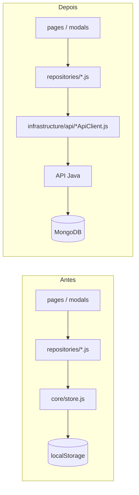

# Guia de Migração: Mock → Backend Real — PEP (FCMSCSP)

Plano passo a passo para substituir o mock atual por um backend Java + MongoDB, sem reescrever o frontend. Nenhuma dessas fases está implementada — este é o roteiro para a próxima etapa do projeto.

## Princípio geral

A camada de repositórios (`assets/js/repositories/*.js`) é o único lugar que muda. Hoje cada repositório importa de `core/store.js` (arrays em memória + `localStorage`); a migração troca essa importação por um cliente HTTP (`infrastructure/api/*ApiClient.js`), mantendo a **mesma assinatura de função** (`list()`, `getById()`, `create()`...). Nenhuma tela (`pages/*.js`, `modals/*.js`) deveria precisar mudar.

## Fases

### Fase 1 — Frontend mock (estado atual, concluído)
- Mock isolado em `infrastructure/mock/mockData.js`.
- Repositórios já existem e já são o ponto de acesso a dado usado pelas telas mais críticas (criação/edição/aprovação).
- **Dependências:** nenhuma. **Riscos:** nenhum (é o estado atual). **Testes:** ver `tests/`.

### Fase 2 — API Java (esqueleto)
- Subir a API Java com autenticação (`POST /auth/login`) e um único endpoint real (`GET /patients`) para validar a integração ponta a ponta antes de migrar tudo.
- **Endpoints:** ver [BACKEND_CONTRACT.md](./BACKEND_CONTRACT.md) (auth + pacientes).
- **Collections:** `users`, `patients` (ver [DATABASE_MONGODB.md](./DATABASE_MONGODB.md)).
- **Mudanças no frontend:** criar `infrastructure/api/httpClient.js` (fetch com header `Authorization`, tratamento de erro padronizado) e `infrastructure/api/patientApiClient.js`. Trocar a implementação de `patientRepository.js` para usar o client de API **atrás de um feature flag** (`core/config.js: USE_MOCK_BACKEND`), permitindo alternar entre mock e API real sem duas versões de código.
- **Riscos:** autenticação — o fluxo de login muda de comparação local para chamada de rede; testar exaustivamente os 4 papéis.
- **Testes:** repetir a suíte de `tests/permissions.test.js` como teste de integração contra a API real.

### Fase 3 — Autenticação completa
- Login, refresh token, logout via API.
- **Mudanças no frontend:** `core/auth.js::doLogin/doLogout` passam a chamar a API em vez de `USERS.find()`. `sanitizarUsuario()` deixa de ser necessário (a API nunca retorna senha).
- **Riscos:** sessão expirada precisa de tratamento explícito (hoje não existe conceito de "token expirado" no mock).

### Fase 4 — Pacientes
- Migrar `patientRepository.js` de fato (não só atrás de flag) para a API.
- **Mudanças no frontend:** nenhuma em `pages/pacientes.js` (é o objetivo do desenho). Paginação real precisa ser adotada na UI (ver [FUTURE_IMPROVEMENTS.md](./FUTURE_IMPROVEMENTS.md), item 7) antes desta fase em produção, se o volume de pacientes justificar.

### Fase 5 — Agendamentos
- Migrar `appointmentRepository.js`. Validar a lógica de conflito de horário no backend (ver [BACKEND_CONTRACT.md](./BACKEND_CONTRACT.md)).

### Fase 6 — Prontuário clínico (anamnese + evolução)
- Migrar `clinicalRepository.js`. **Ponto de maior atenção:** a regra de imutabilidade (anamnese finalizada, evolução sempre append-only) precisa estar corretamente implementada no backend **antes** desta fase — é a regra mais sensível do domínio.

### Fase 7 — Documentos
- Migrar `documentRepository.js` **e** implementar upload real (hoje é 100% simulado). Ver [DATABASE_MONGODB.md](./DATABASE_MONGODB.md) sobre armazenamento de binário fora do MongoDB.

### Fase 8 — Notificações
- Migrar `notificationRepository.js`. Decidir se a lógica de "evolução pendente" (calculada em tempo real hoje) migra para um job no backend ou continua calculada sob demanda no `GET /notifications`.

### Fase 9 — Auditoria
- Migrar `auditRepository.js` (leitura) e trocar `logAudit()` (`core/store.js`) para uma chamada de API — ou, melhor ainda, deixar de existir no frontend: o backend deve auditar a própria requisição recebida, sem depender do frontend "avisar" que algo aconteceu (ver [AUDIT_LOG_SPEC.md](./AUDIT_LOG_SPEC.md)).

### Fase 10 — Remover o mock
- Apagar `infrastructure/mock/` e a flag `USE_MOCK_BACKEND`.
- Remover as credenciais de demonstração do `README.md`.
- **Só fazer esta fase depois que todas as anteriores estiverem em produção e validadas** — até lá, o mock continua sendo o que permite demonstrar e validar o sistema com o cliente.

## Checklist por fase (repetir para cada uma)

- [ ] Endpoints da fase implementados e testados no backend (ver [BACKEND_CONTRACT.md](./BACKEND_CONTRACT.md))
- [ ] `ApiClient` correspondente criado em `infrastructure/api/`
- [ ] Repositório correspondente trocado (mock → API), mesma assinatura pública
- [ ] Testes da fase passando contra a API real (não só contra o mock)
- [ ] Nenhuma tela (`pages/`, `modals/`) precisou mudar — se precisou, é sinal de que a interface do repositório vazou detalhe de implementação e deve ser revista
- [ ] Auditoria da fase revisada em produção antes de seguir para a próxima
